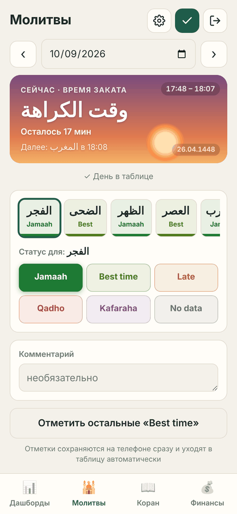
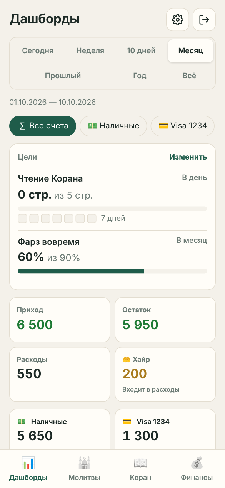
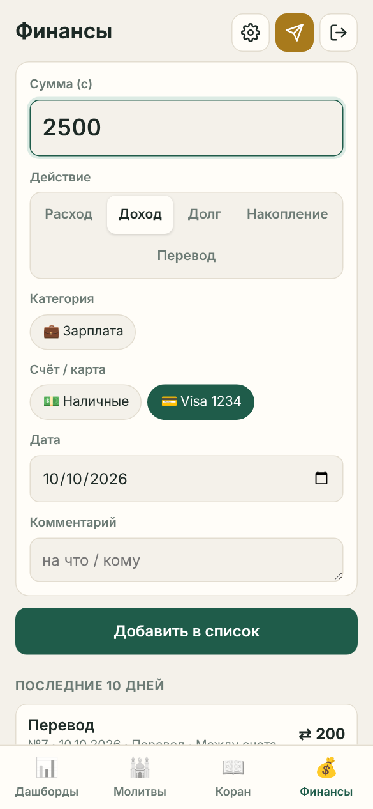
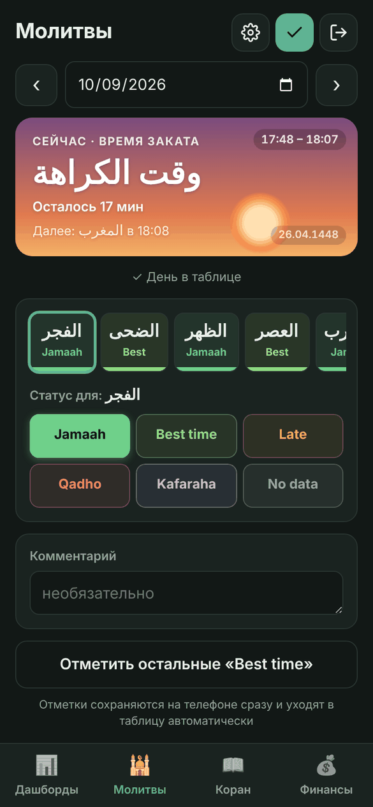
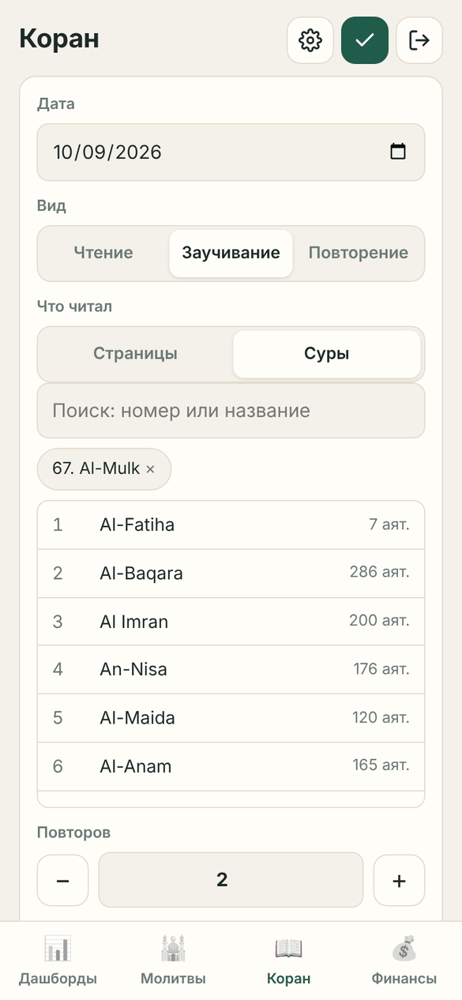

# 🌙 myTracker — Молитвы · Коран · Финансы

Личный трекер для телефона: молитвы, чтение и заучивание Корана, доходы и расходы. Записи вводятся через простой сайт и сохраняются в **вашей собственной Google-таблице**. Нужны только Google-аккаунт и GitHub. Сервера, базы данных и платных сервисов нет.

*A personal mobile tracker for daily prayers, Quran reading/memorization and finances. Frontend on GitHub Pages, backend on Google Apps Script, data in your own Google Sheet. The UI is in Russian and English (switch with the flags in ⚙ Settings).*

<p align="center">
  
  
  
  
</p>

**Главное:** работает без интернета, а дашборды считаются прямо на телефоне — мгновенно.

## Как это работает

```
Телефон — сайт на GitHub Pages (работает и без интернета)
   │  • все данные хранятся на телефоне, дашборды считаются там же
   │  • изменения копятся в очереди и уходят, когда есть интернет
   ▼
Google Apps Script (Code.gs) — проверяет пароль, отдаёт и записывает данные
   │  • если ничего не менялось — отвечает коротко «без изменений»
   ▼
Ваша Google-таблица: Молитвы · Чтение · Финансы · Дашборды · Времена молитв · Справочник · Счета · Регулярные · Настройки
   │
   └─► Telegram-бот (необязательно): напоминания о молитвах, платежах и лимитах
```

Вверху каждого экрана три кнопки: **⚙ Настройки**, **✓ Сохранить** (на вкладке «Финансы» — **➤ Отправить**) и **⎋ Выйти**. Кнопка ✓/➤ на любой вкладке отправляет **всё** неотправленное — молитвы, Коран и финансы; число на ней показывает, сколько записей ждёт.

### 🕌 Молитвы


- Семь молитв. Названия на выбор: арабские **الفجر · الظهر …**, русские (Фаджр, Зухр…), таджикские (Бомдод, Пешин…), английские или свои. Духа и Витр можно скрыть. Плитки прокручиваются вбок. Арабский текст набран шрифтом **Amiri** (лицензия SIL OFL). Файлы шрифта лежат в `fonts/`, поэтому он одинаково выглядит на всех телефонах и работает без интернета.
- Одна строка таблицы на день. Нажмите на молитву, затем на статус: **Jamaah · Best time · Late · Qadho · Kafaraha · No data**. Статусы можно переименовать, скрыть и перекрасить в ⚙ (первые два считаются «вовремя»; Qadho по умолчанию чёрный). После выбора статуса приложение само переходит к следующей молитве. Отметки сохраняются сразу.
- Плитка **«Сейчас»** показывает текущую молитву с анимацией неба. Время молитвы — в правом верхнем углу; ниже — сколько осталось и какая молитва следующая. Время берётся из часов телефона, расписание — из листа «Времена молитв».
- В списке — последние 7 дней. Нажатие на день открывает его.
- **Напоминания** о начале времени молитвы: на телефоне (пока приложение открыто или недавно свёрнуто) и в Telegram (всегда).
<br clear="right">

### 📖 Коран


- Записываются страницы (с … по …, сколько раз повторил) или суры: можно выбрать несколько, есть поиск по 114 сурам с числом аятов.
- Вид записи: **чтение · заучивание · повторение**.
- На дашборде видны страницы по дням и прогресс хифза: сколько из 604 страниц и 114 сур заучено.
- **Заучено ранее** (⚙ → Коран): отметьте суры (есть кнопки «Джуз 30», «Джуз 29») или страницы, которые уже знаете. На карте хифза они зелёные и бледнеют, если их долго не повторять; сроки «зелёный» и «бледнеет» настраиваются.
- В списке — последние 10 дней. Нажатие на запись открывает её для изменения.
<br clear="right">

### 💰 Финансы


- Действия **Расход · Доход · Долг · Накопление · Перевод**, у каждого свои категории с иконками.
- **Счета и карты.** У каждой записи есть счёт: «Наличные», «Visa ••1234» и т. д. Список счетов, иконки и начальные остатки задаются в ⚙ → Финансы. Один счёт отмечается как основной, и для каждого действия можно выбрать свой счёт по умолчанию (например, «Доход» → зарплатная карта). В форме счёт подставляется сам, но его можно поменять одним нажатием.
- **Перевод** между своими счетами: «Откуда» и «Куда». Перевод не считается ни приходом, ни расходом.
- Ненужную карту можно убрать в архив 📦: она исчезнет из формы, а старые записи и остаток сохранятся.
- У каждой категории есть **поток**: *Приход* увеличивает остаток, *Расход* уменьшает, *Нет* не влияет. По умолчанию «Взял в долг» и «Вернули мой долг» — приход, «Погасил свой долг», «Дал в долг» и «Отложил» — расход.
- Действия, категории, иконки и потоки можно добавлять, переименовывать и удалять в ⚙ «Настройках». При переименовании старые записи в таблице тоже переименовываются.
- Хайр — категория расхода, подробности пишутся в комментарии.
- В поле суммы можно писать выражение, например `27+110`.
- **Бюджеты:** месячный лимит по категории. В форме видно, сколько осталось; при 80% и при превышении приложение предупреждает (и Telegram, если подключён).
- **Регулярные платежи:** аренда, связь, кредит… Повтор каждый день / неделю / месяц / год. В день оплаты платёж появляется вверху вкладки «Финансы» с кнопками «Оплатить» и «Пропустить». С пометкой «Авто» запись добавляется сама ночью.
- Новые записи копятся на телефоне и уходят в таблицу одной пачкой: кнопкой ➤ или **автоматически раз в минуту**.
<br clear="right">

### 📊 Дашборды


- **Приход | Остаток / Расходы | Хайр.** Остаток — реальные деньги на всех счетах на конец периода (начальные остатки + все записи), под ним — изменение за период. Зелёный, если больше нуля, красный — если меньше. Ниже — долги и накопления.
- **Плитки карт:** для каждой карты — баланс на конец выбранного периода, а под ним приход, расход и остаток на начало периода. Можно оставить только баланс. Какие карты показывать и что на плитке, выбирается в ⚙ → Дашборд → «Плитки карт». Нажатие на плитку переключает весь дашборд на эту карту, повторное нажатие возвращает все счета.
- **Приход по категориям** — рядом с расходами по категориям.
- **Счета и карты:** остаток на каждом счёте (начальный остаток + все записи + переводы) и общий итог. Над блоками — фильтр по счёту: при выборе одной карты переводы на неё считаются приходом, а с неё — расходом.
- **Блоки на выбор** (⚙ → «Дашборд»): включайте и выключайте блоки, меняйте их порядок, задавайте **свой период каждому блоку** (сегодня, неделя, месяц…). Есть:
  - финансы, долги и накопления;
  - средний расход в день;
  - цели;
  - плитки карт и список счетов с остатками;
  - ближайшие платежи и бюджеты месяца;
  - расходы и приход по категориям;
  - таблица статусов молитв;
  - серия «все фарзы вовремя»;
  - сетка молитв по дням;
  - Коран по дням;
  - карта хифза из 604 страниц.
- Расходы по категориям, статусы молитв и процент «вовремя», страницы Корана по дням.
- Периоды: сегодня · неделя · 10 дней · месяц · прошлый месяц · год · всё время.
- **Цели:** страниц Корана в день, хифз за месяц, повторение за неделю, сумма накоплений (можно со сроком), процент фарзов вовремя. Прогресс, отметки за 7 дней и сколько нужно в день, чтобы успеть.
- В самой Google-таблице есть лист «Дашборды» с формулами и графиками.
<br clear="right">

### Без интернета и без ожидания
- **Офлайн.** Записи можно вводить без интернета. Они сохраняются на телефоне и сразу видны в списках и дашбордах. Когда связь появится, приложение отправит их само. Строка вверху показывает, сколько записей ждёт отправки.
- **Без дубликатов.** Если ответ сервера потерялся, повторная отправка той же записи не создаёт копию.
- **Всё на телефоне.** История загружается одним запросом. Смена даты молитв и периода дашборда работает мгновенно, без запросов. Если в таблице ничего не менялось, сервер отвечает «без изменений», и ничего не скачивается.
- **Открывается без сети.** Сайт можно поставить на главный экран как приложение (иконка 🌙): он откроется даже в режиме «В самолёте».

### ⚙ Настройки
Вверху — флаги 🇷🇺 / 🇬🇧: язык переключается одним нажатием. Ниже — раскрывающиеся разделы:
- **Общие** — автоотправка, тема, вкладка при запуске, перезагрузка данных, **экспорт и импорт CSV**, скрытые записи.
- **Молитвы** — названия молитв, показ Духа и Витр, статусы (переименовать, скрыть), кнопка «Отметить остальные», переход к следующей молитве, плитка «Сейчас», дней в списке.
- **Коран** — вид и тип записи по умолчанию, продолжение со следующей страницы, дней в списке.
- **Финансы** — счета и карты, регулярные платежи, бюджеты, действия и категории, валюта, дней в списке.
- **Цели** — цели по Корану, хифзу, накоплениям и молитвам.
- **Напоминания** — уведомления на телефоне и Telegram.
- **Дашборд** — период при открытии, блоки, их порядок и периоды, плитки карт.

Тема, язык и вид списков хранятся на телефоне. Счета, категории, названия молитв, статусы, бюджеты, цели, платежи и напоминания хранятся в таблице и одинаковы на всех устройствах.

### Удобства
- **Свайп влево** скрывает запись из списка, в таблице она остаётся. Вернуть скрытые можно в ⚙ «Настройках».
- **Автоотправка** — сразу после сохранения, раз в минуту и при сворачивании приложения. Её можно выключить в ⚙.
- **Ручная правка таблицы** тоже подхватывается: при следующем открытии приложение загрузит изменения.
- **Тёмная тема** — по настройке телефона или вручную в ⚙.
- Работает на узких экранах, от 320 px (iPhone SE).

## Безопасность
- **Паролей в коде нет.** Пароль хранится только в свойствах Apps Script (`APP_PASSWORD`). После входа телефон получает подписанный токен на 30 дней.
- Если 5 раз подряд ввести неверный пароль, вход блокируется на 15 минут.
- Все данные лежат в вашей Google-таблице. Кроме вас, их никто не видит.

## Установка (≈15 минут)

### 1. Google-таблица и Apps Script
1. Откройте **[sheets.new](https://sheets.new)**: создастся пустая таблица. Назовите её, например, «myTracker».
2. Выберите **Расширения → Apps Script**.
3. Замените содержимое `Code.gs` содержимым файла [`apps-script/Code.gs`](apps-script/Code.gs).
4. В **Настройках проекта ⚙** включите «Показывать файл appsscript.json» и вставьте в него [`apps-script/appsscript.json`](apps-script/appsscript.json). При необходимости поменяйте `timeZone` на свой часовой пояс.
5. Там же, в разделе **Свойства скрипта**, добавьте свойство `APP_PASSWORD` со своим паролем.
6. В редакторе выберите функцию **`setup`** и нажмите **▶ Выполнить**. Google попросит доступ к таблице и к запуску по расписанию — разрешите. Скрипт сам создаст все листы, списки, цвета и дашборды с графиками.

### 2. Публикация API
1. **Начать развертывание → Новое развертывание → ⚙ Веб-приложение**.
2. Запуск от имени: **Я**. Доступ: **Все**. Без пароля API ничего не отдаёт.
3. Скопируйте **URL веб-приложения**, он заканчивается на `/exec`.

### 3. Сайт на GitHub Pages
1. Нажмите **Use this template** (или **Fork**) — у вас появится копия этого репозитория. Можно сделать её приватной: с GitHub Pro сайт работает и из приватного репозитория.
2. Вставьте свой URL в `config.js`.
3. **Settings → Pages → Deploy from a branch → main / (root) → Save**.
4. Через минуту сайт откроется по адресу `https://<логин>.github.io/<репозиторий>/`. На телефоне используйте «Добавить на главный экран».

### 4. Telegram-напоминания (необязательно)
1. В Telegram откройте **@BotFather** → `/newbot` → придумайте имя. BotFather пришлёт **токен** вида `123456:ABC…`.
2. В Apps Script: **Настройки проекта → Свойства скрипта** → добавьте `TG_TOKEN` с этим токеном. Токен хранится только там — не в коде и не на телефоне.
3. В редакторе Apps Script выберите функцию **`authorize`** и нажмите **▶ Выполнить** → «Проверить разрешения» → «Разрешить». Без этого Google не даёт скрипту обращаться к Telegram.
4. Напишите своему боту `/start`.
5. В приложении: **⚙ → Напоминания → Подключить**, затем отметьте, о чём напоминать, и нажмите «Сохранить напоминания».

Скрипт каждую ночь ставит напоминания на начала молитв (по листу «Времена молитв»), раз в день присылает список платежей и сообщает о превышении лимитов.

### 5. Времена молитв
Вставьте на лист **«Времена молитв»** расписание на месяц:

| Ҳафта | Сана мелодӣ | Сана ҳиҷрӣ | Бомдод | Пешин | Аср | Вақти макрӯҳ | Шом | Хуфтан |
|---|---|---|---|---|---|---|---|---|
| Ҷумъа | 09.10.2026 | 27.04.1448 | 04:59 - 06:25 | 12:40 - 16:11 | 16:12 - 17:45 | 17:46 - 18:05 | 18:06 - 18:46 | 19:36 - 04:58 |

Названия колонок можно менять — важен только их порядок. Время пишется как «начало - конец».

## Настройка под себя
- **Счета, действия, категории, иконки и потоки** меняются прямо в приложении: ⚙ → «Финансы». **Статусы и виды чтения** — на листе «Справочник» таблицы.
- **Срок входа и число попыток** задаются в начале `Code.gs`, в блоке `CFG`.

## Обновление
1. Замените `Code.gs` и запустите `setup()` ещё раз. Это безопасно: данные не удаляются, старая структура таблицы обновляется автоматически.
2. В Apps Script выберите **Развертывания → Управление → ✏ → Версия: Новая версия → Развернуть**. URL при этом не меняется.
3. Замените файлы сайта.

Сайт и скрипт сверяют номер версии (`APP_VERSION` в `app.js` и `Code.gs`). Если устарел сайт, он сам перезагружается. Если не развернута новая версия скрипта, вверху появится подсказка. Меняя версию, обновите её в обоих файлах и поменяйте `?v=` в `index.html`.

## Частые вопросы
- **«Нужно войти заново».** Истёк токен, вы сменили пароль или запустили «Трекер → Выйти на всех устройствах».
- **Изменения в коде не видны.** Нужно развернуть новую версию веб-приложения (см. «Обновление»).
- **Как удалить запись?** Удалите строку прямо в Google-таблице. Свайп в приложении только скрывает запись.

## Экспорт и импорт
⚙ → Общие → «Экспорт и импорт CSV». Файл открывается в Excel и Google Таблицах (разделитель `;`, UTF-8). Импорт принимает такой же файл: записи с уже существующим номером пропускаются, у молитв заполняются только пустые отметки.

## Структура
```
index.html, app.js, styles.css   — сайт
i18n.js                          — английский язык интерфейса
sw.js, manifest.json, icons/     — офлайн-запуск и иконка на главном экране
fonts/                           — арабский шрифт Amiri (SIL OFL)
config.js                        — URL вашего Apps Script
apps-script/Code.gs              — бэкенд
apps-script/appsscript.json      — манифест (часовой пояс, настройки веб-приложения)
docs/screenshots/                — скриншоты для README
```
